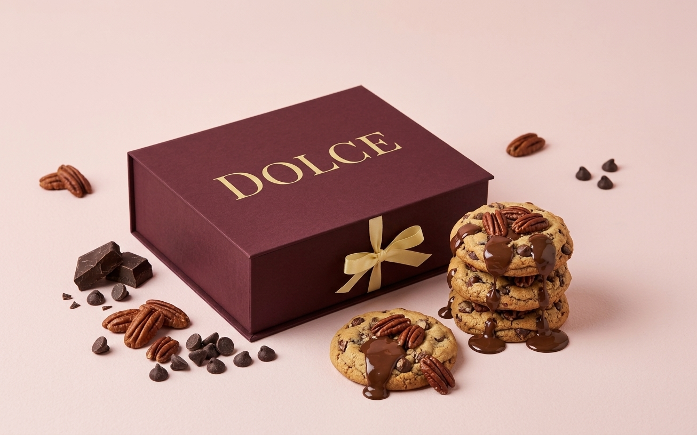

# DOLCE — Alta Repostería de Autor

Landing page de alta gama desarrollada bajo la filosofía estética **Quiet Luxury**, diseñada con un enfoque minimalista, paleta cromática sobria (crema y borgoña profundo) y tipografías editoriales.

---

## 🛠️ Tecnologías y Metodologías
* **HTML5** (Estructura semántica)
* **CSS3** (Grid Layout, Flexbox, Custom Properties y diseño **Mobile First**)
* **JavaScript (ES6+)** (Carrusel rotativo automático de testimonios y acordeón de FAQ con animaciones fluidas)
* **Prototipado:** Figma (Diseño UI/UX de alta fidelidad)

---

## ✨ Características del Proyecto
* **Hero Section:** Imagen principal con recorte editorial y retícula adaptativa.
* **Galería de Sabores:** Grilla de 6 variedades con tarjetas verticales de gran formato (*portrait*).
* **Sección de Pre-Order:** Bloque explicativo del modelo de reserva y suscripción a *El Club Dolce*.
* **Carrusel de Testimonios (*DOLCE Love*):** Rotación automática con control manual por líneas indicadoras.
* **Preguntas Frecuentes (FAQ):** Acordeón interactivo de extremo a extremo con despliegue animado mediante CSS Grid.

---

*Diseñado y desarrollado por Vita Simao.*